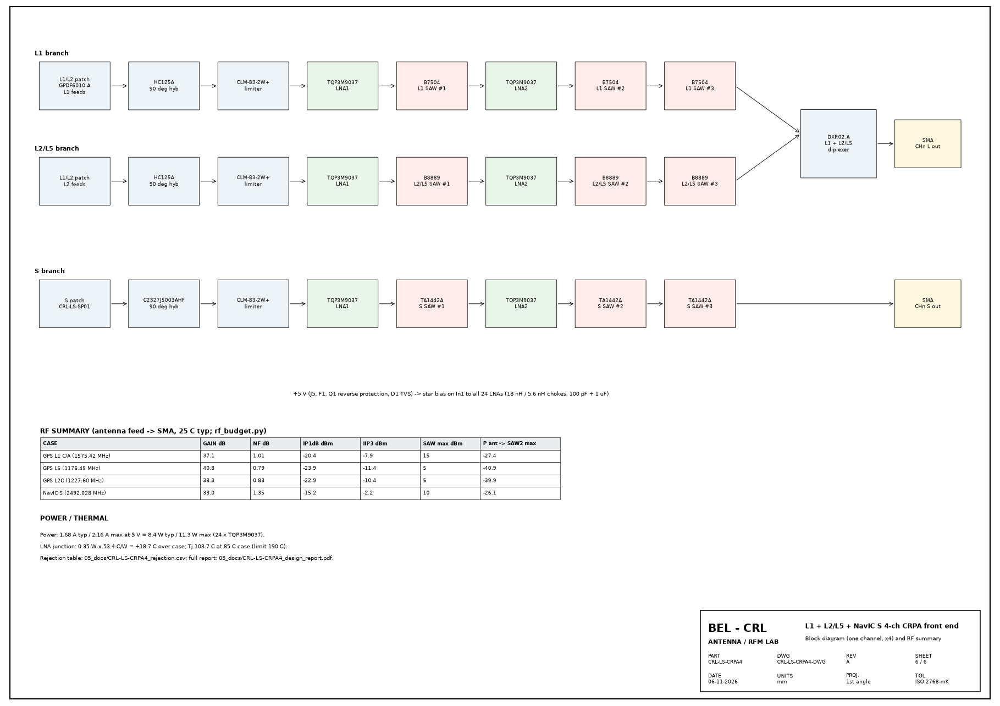
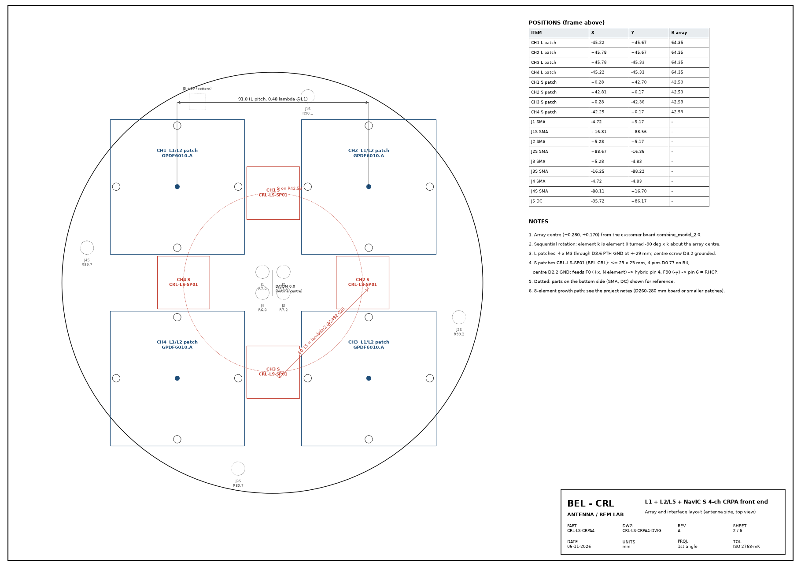
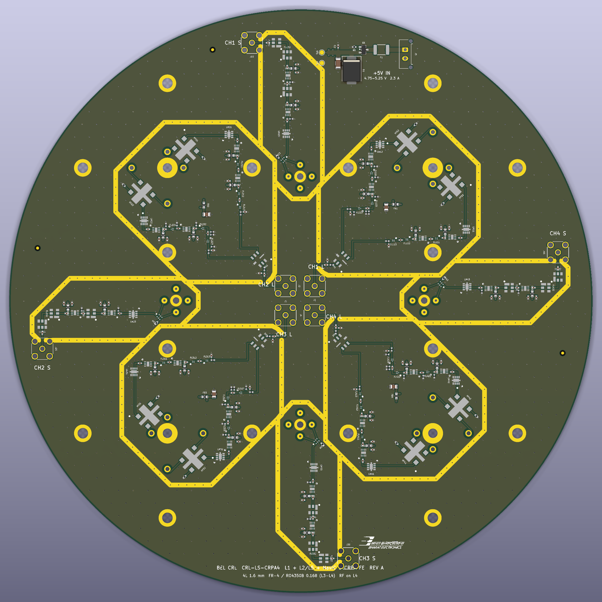
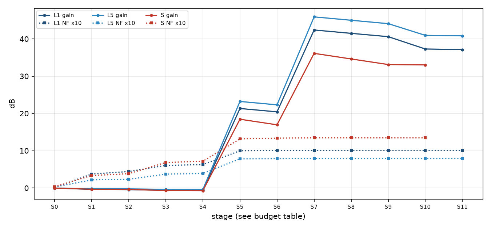
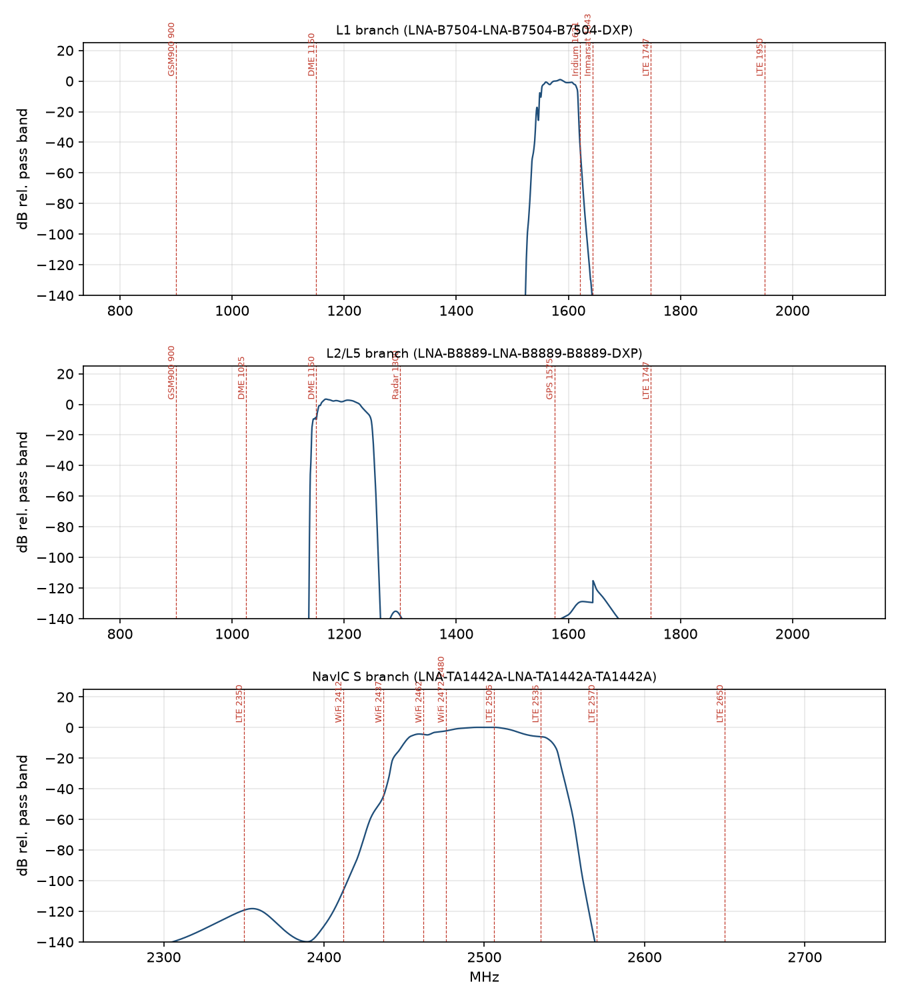
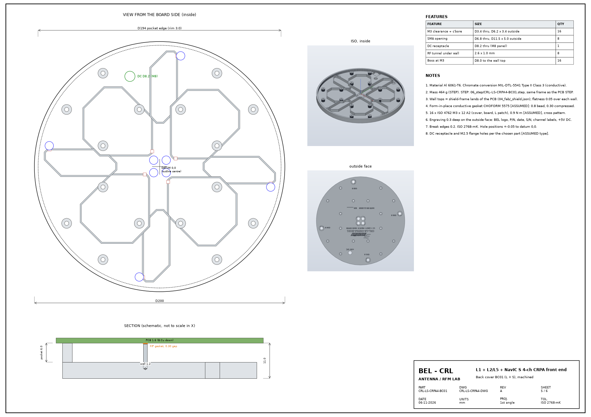

# CRL-LS-CRPA4 - L1 + L2/L5 + NavIC S 4-channel CRPA front end
## Design report, Rev A

BEL - CRL, Antenna / RFM lab. Date 06-11-2026. Project folder `projects/02_ls-crpa4-rf-module`.

## 1. Summary

CRL-LS-CRPA4 is a D200 mm, 4-layer active antenna board for a 4-element controlled-reception-pattern antenna (CRPA). Each
element has a stacked GPS L1/L2 patch (GPDF6010.A) and a NavIC S patch (CRL-LS-SP01, BEL CRL). Every element feeds
three filtered, amplified branches (L1, L2/L5, S): 2 LNAs and 3 SAW filters per branch, as in projects 16 and 17.
L1 and L2/L5 are combined in a DXP.02.A diplexer per channel. Outputs: 4 L SMA + 4 S SMA, +5 V on one DC connector.
A machined aluminium back cover (BC01) gives every chain its own shielded cavity.

| Case | Gain dB | NF dB | Input P1dB dBm | IIP3 dBm | 2nd SAW rating dBm | Antenna CW that reaches it dBm |
|---|---|---|---|---|---|---|
| GPS L1 C/A (1575.42 MHz) | 37.1 | 1.01 | -20.4 | -7.9 | 15 | -27.4 |
| GPS L5 (1176.45 MHz) | 40.8 | 0.79 | -23.9 | -11.4 | 5 | -40.9 |
| GPS L2C (1227.60 MHz) | 38.3 | 0.83 | -22.9 | -10.4 | 5 | -39.9 |
| NavIC S (2492.028 MHz) | 33.0 | 1.35 | -15.2 | -2.2 | 10 | -26.1 |

Supply 1.68 A typ / 2.16 A max at 5 V (8.4 W typ). Board DRC: 0 violations, 0 unconnected.
Fabrication package complete (Gerber X2, Excellon, pick-and-place, IPC-D-356, BOM with 40 lines / 313 placements).

**Key findings (section 7):**

1. Weak rejection close to the bands: DME / TACAN 1150 9.9 dB; WiFi ch11 2462 4.4 dB; WiFi ch13 / BT high 2472-2480 2.2 dB; LTE B41 low 2506 -0.1 dB; LTE B7 UL 2535 5.9 dB.
2. Gain and filter ratings: an in-band CW jammer of -41 dBm (L2/L5),
   -27 dBm (L1) or -26 dBm (S) at the antenna drives the 2nd SAW to its
   power rating. The input 1 dB compression point is -24 to -20 dBm (L) and
   -15 dBm (S). For a CRPA, which must stay linear under jamming, this is the main Rev B item.

## 2. Design basis and decisions

| Item | Decision | Source |
|---|---|---|
| Bands | GPS L1 1575.42; wide L2/L5 1164-1240; NavIC S 2492.028 MHz | user, 2026-11-05 |
| Elements | 4, square, sequential rotation (-90 deg x k) | customer board combine_model_2.0 |
| L spacing | 91.0 mm (0.48 lambda at L1) | customer board |
| S spacing | 60.15 mm = lambda/2 at 2492.028 MHz, R 42.53 mm | user, 2026-11-06 |
| Chain | limiter -> LNA -> SAW -> LNA -> SAW -> SAW per branch | projects 16 / 17 |
| Supply | +5 V, one DC connector, reverse-polarity PFET, fuse, TVS | user |
| Outputs | 8 SMA (L and S separate) + DC | user |
| Board | D200 mm, same size as the L-band board | user |

## 3. Architecture

Per element: the patch feeds go to a 90 deg hybrid (HC125A for L1 and L2, Xinger C2327J5003AHF for S), which combines
them into RHCP. The hybrid's isolated port goes to 50 ohm. Next comes a CLM-83-2W+ PIN limiter (CW +32 dBm, limited
output +11.5 dBm typ), then the LNA / SAW cascade. S hybrid wiring: F0 -> pin 4 (direct), F90 -> pin 6 (coupled).
This is RHCP because F90 sits +90 deg counter-clockwise (top view) from F0. `build_pcb.py` checks it on every build.

### Array geometry

The S patches sit at lambda/2 (60.15 mm) so the S sub-array has no grating lobes and keeps full nulling
depth. Each S patch clears its L neighbours by about 1 mm (25 x 25 mm patch). Mutual coupling L-to-S must be measured
(section 9).

## 4. Stack-up and transmission lines

| Layer | Type | mm | er | Note |
|---|---|---|---|---|
| F.Mask | mask | 0.010 | 3.8 | green LPI |
| F.Cu | copper | 0.035 |  | L1: solid GND = antenna ground plane |
| Core1 | core | 0.710 | 4.4 | FR-4 high-Tg core (IT-180A) |
| In1.Cu | copper | 0.035 |  | L2: GND + per-channel +5V star traces |
| PP1 | prepreg | 0.540 | 4.3 | FR-4 prepreg 2x2116 + 1x1080 (bonds FR-4 to RO4350B) |
| In2.Cu | copper | 0.035 |  | L3: solid GND, RF reference for L4 |
| Core2 | core | 0.168 | 3.66 | Rogers RO4350B 0.168 mm (6.6 mil), tan d 0.0037 |
| B.Cu | copper | 0.035 |  | L4: RF lines + all SMD parts, ENIG |
| B.Mask | mask | 0.010 | 3.8 | green LPI |

The 50 ohm microstrip on L4 is 0.34 mm over the RO4350B 0.168 mm core to the L3 ground. Loss is 0.066 dB/cm at
2.5 GHz, against 0.121 dB/cm for the same line on FR-4 7628. L1 is the solid antenna ground plane. L2 carries the
per-channel +5 V star traces inside GND. Fence vias run along every RF line; frame vias sit at 2.5 mm pitch on every
shield land.

## 5. Layout

All SMD parts are on L4 (bottom); the patches are on L1 (top). Each L channel sits inside an octagonal ground frame,
and each S chain inside a strip frame in the axis gap between L channels. Neighbouring frames share walls, so one
cover wall serves both cavities. The TA1442A and C2327J5003AHF land patterns follow the vendor drawings (Tai-Saw Rev 1,
TTM Rev K). Ground pads carry filled vias (IPC-4761 VII) for the lowest ground inductance.

## 6. RF budget (antenna feed -> SMA, 25 C typical)

Data: project 16 Touchstone models (LNA, SAW, hybrid, diplexer), project 17 stage values for the L chain, this
board's RF track lengths. Line loss is scaled with f^0.75 from 0.066 dB/cm at 2.5 GHz [ESTIMATE]. The CLM-83-2W+
loss at S is 0.30 dB [ESTIMATE]. The S LNA noise figure is 0.60 dB (NFmin 0.51 dB at 2.5 GHz + 0.1 dB match) [ESTIMATE].

**GPS L1 C/A (1575.42 MHz)**

| # | Stage | G dB | NF dB | Cum. G dB | Cum. NF dB | Note |
|---|---|---|---|---|---|---|
| 0 | Feed line, patch pin -> hybrid | -0.013 | 0.013 | -0.01 | 0.013 | 2.7 mm |
| 1 | HC125A hybrid (RHCP combine) | -0.361 | 0.361 | -0.37 | 0.374 | p16 model |
| 2 | Line, hybrid -> limiter | -0.069 | 0.069 | -0.44 | 0.442 | 14.7 mm |
| 3 | CLM-83-2W+ limiter | -0.165 | 0.165 | -0.61 | 0.607 | p17 |
| 4 | Line, limiter -> LNA1 | -0.02 | 0.02 | -0.63 | 0.627 |  |
| 5 | LNA1 TQP3M9037 + bias | 21.953 | 0.372 | 21.33 | 0.999 | p16 model |
| 6 | B7504 #1 | -0.893 | 0.893 | 20.43 | 1.005 |  |
| 7 | LNA2 TQP3M9037 + bias | 21.953 | 0.372 | 42.39 | 1.008 |  |
| 8 | B7504 #2 | -0.893 | 0.893 | 41.49 | 1.008 |  |
| 9 | B7504 #3 | -0.893 | 0.893 | 40.6 | 1.008 |  |
| 10 | DXP.02.A combiner | -3.308 | 3.308 | 37.29 | 1.008 | p16 model |
| 11 | Output line + DC block -> SMA | -0.175 | 0.175 | 37.12 | 1.008 |  |

**GPS L5 (1176.45 MHz)**

| # | Stage | G dB | NF dB | Cum. G dB | Cum. NF dB | Note |
|---|---|---|---|---|---|---|
| 0 | Feed line, patch pin -> hybrid | -0.027 | 0.027 | -0.03 | 0.027 | 7.1 mm |
| 1 | HC125A hybrid (RHCP combine) | -0.191 | 0.191 | -0.22 | 0.218 | p16 model |
| 2 | Line, hybrid -> limiter | -0.017 | 0.017 | -0.23 | 0.234 | 4.5 mm |
| 3 | CLM-83-2W+ limiter | -0.138 | 0.138 | -0.37 | 0.372 | p17 |
| 4 | Line, limiter -> LNA1 | -0.016 | 0.016 | -0.39 | 0.389 |  |
| 5 | LNA1 TQP3M9037 + bias | 23.606 | 0.394 | 23.22 | 0.783 | p16 model |
| 6 | B8889 #1 | -0.911 | 0.911 | 22.31 | 0.787 |  |
| 7 | LNA2 TQP3M9037 + bias | 23.606 | 0.394 | 45.91 | 0.789 |  |
| 8 | B8889 #2 | -0.911 | 0.911 | 45.0 | 0.789 |  |
| 9 | B8889 #3 | -0.911 | 0.911 | 44.09 | 0.789 |  |
| 10 | DXP.02.A combiner | -3.138 | 3.138 | 40.95 | 0.789 | p16 model |
| 11 | Output line + DC block -> SMA | -0.132 | 0.132 | 40.82 | 0.789 |  |

**GPS L2C (1227.60 MHz)**

| # | Stage | G dB | NF dB | Cum. G dB | Cum. NF dB | Note |
|---|---|---|---|---|---|---|
| 0 | Feed line, patch pin -> hybrid | -0.027 | 0.027 | -0.03 | 0.027 | 7.1 mm |
| 1 | HC125A hybrid (RHCP combine) | -0.217 | 0.217 | -0.24 | 0.244 | p16 model |
| 2 | Line, hybrid -> limiter | -0.017 | 0.017 | -0.26 | 0.262 | 4.5 mm |
| 3 | CLM-83-2W+ limiter | -0.142 | 0.142 | -0.4 | 0.404 | p17 |
| 4 | Line, limiter -> LNA1 | -0.017 | 0.017 | -0.42 | 0.42 |  |
| 5 | LNA1 TQP3M9037 + bias | 23.386 | 0.396 | 22.97 | 0.816 | p16 model |
| 6 | B8889 #1 | -1.455 | 1.455 | 21.51 | 0.824 |  |
| 7 | LNA2 TQP3M9037 + bias | 23.386 | 0.396 | 44.9 | 0.826 |  |
| 8 | B8889 #2 | -1.455 | 1.455 | 43.44 | 0.826 |  |
| 9 | B8889 #3 | -1.455 | 1.455 | 41.99 | 0.826 |  |
| 10 | DXP.02.A combiner | -3.555 | 3.555 | 38.43 | 0.827 | p16 model |
| 11 | Output line + DC block -> SMA | -0.137 | 0.137 | 38.29 | 0.827 |  |

**NavIC S (2492.028 MHz)**

| # | Stage | G dB | NF dB | Cum. G dB | Cum. NF dB | Note |
|---|---|---|---|---|---|---|
| 0 | Feed line, patch pin -> hybrid | -0.034 | 0.034 | -0.03 | 0.034 | 5.2 mm |
| 1 | C2327J5003AHF hybrid (RHCP combine) | -0.3 | 0.3 | -0.33 | 0.334 | TTM Rev K typ excess IL |
| 2 | Line, hybrid -> limiter | -0.05 | 0.05 | -0.38 | 0.384 | 7.6 mm |
| 3 | CLM-83-2W+ limiter | -0.3 | 0.3 | -0.68 | 0.684 | [ESTIMATE] 0.5 dB typ broadband, 0.17 dB at L1 (p17) |
| 4 | Line, limiter -> LNA1 | -0.034 | 0.034 | -0.72 | 0.718 |  |
| 5 | LNA1 TQP3M9037 (2.3-2.6 GHz match) | 19.168 | 0.6 | 18.45 | 1.318 | NFmin 0.51 dB @2.5 GHz + 0.1 match [ESTIMATE] |
| 6 | TA1442A #1 | -1.5 | 1.5 | 16.95 | 1.337 | Tai-Saw model (p16 A24) |
| 7 | LNA2 TQP3M9037 | 19.168 | 0.6 | 36.12 | 1.347 |  |
| 8 | TA1442A #2 | -1.5 | 1.5 | 34.62 | 1.347 |  |
| 9 | TA1442A #3 | -1.5 | 1.5 | 33.12 | 1.347 |  |
| 10 | Output line + DC block -> SMA | -0.095 | 0.095 | 33.02 | 1.347 | incl. SMA launch [ESTIMATE] |

The system noise figure is set ahead of LNA1: hybrid, limiter and lines add 0.4-0.7 dB. Gain at the SMA is 33-41 dB,
before the cable to the CRPA electronics.

## 7. Interference rejection, linearity and filter power

### 7.1 Rejection

| Branch | Interferer | MHz | Rejection dB (rel. pass band) |
|---|---|---|---|
| L1 | GSM900 / LTE B8 UL 900 | 900 | >80 |
| L1 | DME / TACAN 1150 | 1150 | >80 |
| L1 | Inmarsat UL 1643 | 1643 | >80 |
| L1 | Iridium 1621 | 1621 | 43.3 |
| L1 | LTE B3 UL 1747 | 1747 | >80 |
| L1 | LTE B1 UL 1950 | 1950 | >80 |
| L2/L5 | GSM900 / LTE B8 UL 900 | 900 | >80 |
| L2/L5 | DME / TACAN 1025 | 1025 | >80 |
| L2/L5 | DME / TACAN 1150 | 1150 | 9.9 |
| L2/L5 | Radar / ATC 1300 | 1300 | >80 |
| L2/L5 | GPS L1 1575 | 1575 | >80 |
| L2/L5 | LTE B3 UL 1747 | 1747 | >80 |
| S | LTE B40 (2300-2400) 2350 | 2350 | >80 |
| S | WiFi ch1 / BT low 2412 | 2412 | >80 |
| S | WiFi ch6 2437 | 2437 | 45.0 |
| S | WiFi ch11 2462 | 2462 | 4.4 |
| S | WiFi ch13 / BT high 2472-2480 | 2476 | 2.2 |
| S | LTE B41 low 2506 | 2506 | -0.1 |
| S | LTE B7 UL 2535 | 2535 | 5.9 |
| S | LTE B41 / B7 2570 | 2570 | >80 |
| S | LTE B41 2650 | 2650 | >80 |

The cascaded model gives over 100 dB far from the bands. A real board leaks around the filters (cover cavities,
ground, bias lines), so anything above 80 dB is quoted as ">80". Near-band results that matter:
- **NavIC S:** the TA1442A curve stays within about 3 dB loss from roughly 2445 to 2540 MHz. The "5 MHz bandwidth"
  in its datasheet is only the window it is specified over. WiFi channels 11-13, Bluetooth, LTE B41 (2496-2690,
  used in India) and B7 uplink (2500-2570) therefore pass almost unattenuated. Wi-Fi ch6 gets 45 dB.
- **L2/L5:** DME / TACAN replies up to 1150-1213 MHz overlap the wide 1164-1240 MHz band; only about 10 dB at 1150 MHz.
- **L1:** Iridium (1616-1626 MHz) 43 dB; Inmarsat uplink > 80 dB.

### 7.2 Linearity and SAW power rating

| Branch | 2nd SAW | Rating | Gain ahead of SAW #1 / #2 | CW at antenna that reaches the rating (SAW #1 / #2) |
|---|---|---|---|---|
| L1 | B7504 | 15 dBm (out of band, 5000 h) | about 21 / 42 dB | -6.3 / -27.4 dBm |
| L2/L5 | B8889 | 5 dBm CW (2000 h at 55 C) | about 23 / 45 dB | -18.2 / -40.9 dBm |
| S | TA1442A | 10 dBm | about 17 / 35 dB | -8.4 / -26.1 dBm |

The limiter caps the LNA1 input at about +11.5 dBm, but LNA2 can still deliver +20 dBm into SAW #2. A jammer
30-40 dB above the noise floor near the antenna is normal for a CRPA. The present gain distribution then overdrives
SAW #2 and compresses the chain before the nulling electronics see the signal.

**Rev B recommendations:**

1. Cut the gain to about 25-28 dB per branch. Use one LNA ahead of the first SAW and a lower-gain second stage, or a
   3-6 dB pad between LNA2 and SAW #2. This raises the input P1dB to about -10 dBm and keeps SAW #2 below rating.
2. For S, add a second-stage filter with a sharp upper skirt (ceramic / BAW, LTE B41 and B7 rejection) or a
   tighter S SAW. For L2/L5, decide whether the band must start at 1164 MHz (DME); 1166-1240 with a steeper
   filter removes DME.
3. Specify the receiver-side requirement: required gain at the antenna port, J/S to survive, recovery time.

## 8. Power and thermal

| Item | Value |
|---|---|
| LNAs | 24 x TQP3M9037, 70 mA typ / 90 mA max at 5 V |
| Supply current | 1.68 A typ / 2.16 A max |
| Power | 8.4 W typ / 11.3 W max (5.25 V) |
| LNA dissipation | 0.35 W each, theta_jc 53.4 C/W -> +18.7 C over the case |
| Tj at 85 C case | 103.7 C (limit for > 1e6 h MTTF: 190 C) |
| Heat path | exposed pad -> filled vias -> L3 / L2 GND -> cover walls through the conductive gasket |

The thermal margin is large. The open point is the case temperature inside the sealed cover at the platform's maximum
ambient (section 9).

## 9. Back cover BC01 (L + S)

One machined Al 6061-T6 part, D200 mm, 11 mm high, 464 g, chromate conversion (conductive). Walls 1.2 mm wide run on
every shield-frame land, so each L channel and each S chain has its own cavity. A form-in-place conductive gasket goes
on the wall tops. RF tunnels 2.6 x 1.0 mm pass under the walls. There are 8 recessed SMA openings, an M8 DC
receptacle, and 16 x M3 through cover, board and L patch. The outside face is engraved with the BEL logo, P/N,
date, S/N and channel labels.

## 10. Manufacturing package

| File | Content |
|---|---|
| `04_fab/CRL-LS-CRPA4_Gerbers.zip` | Gerber X2 (4 Cu, mask, paste, silk, outline), Excellon PTH/NPTH + drill map |
| `04_fab/CRL-LS-CRPA4_CPL_bottom.csv` | pick-and-place, bottom side |
| `04_fab/CRL-LS-CRPA4.d356` | IPC-D-356 netlist for the bare-board electrical test |
| `04_fab/CRL-LS-CRPA4_BOM.csv / .xlsx` | 40 lines incl. mechanical items |
| `04_fab/CRL-LS-CRPA4_FAB_NOTES.md` | stack-up, impedance, finish, via plugging, assembly and test |
| `06_step/CRL-LS-CRPA4_PCB.step`, `06_step/CRL-LS-CRPA4-BC01.step` | board and cover in one frame |
| `07_drawings/CRL-LS-CRPA4_DRAWINGS.pdf` | 6 sheets: fab, array, assembly bottom / top, cover, block diagram |

## 11. Open items and review gaps

- Inputs needed: CRL-LS-SP01 drawing and measured S11 / axial ratio; L patch fixing holes (board D3.6 / D1.35 vs
  GPDF6010.A D1.8 / D1.1); supply bus (5 V or 28 V); platform (MIL-STD-810 / 461 levels); CRPA processor gain /
  match / delay requirements; radome; interference environment.
- Not yet built: test boards (one L channel, one S chain, THRU line) and their cover.
- Full list: `05_docs/CRL-LS-CRPA4_design_review_gaps.md`.

## 12. Assumptions

Values marked [ESTIMATE] / [ASSUMED] in the tables; project 16 `assumptions_log.md` (copied in `00_reference/p16`) for
the component models. All data at 25 C typical; no temperature, part-to-part or ageing spread.
