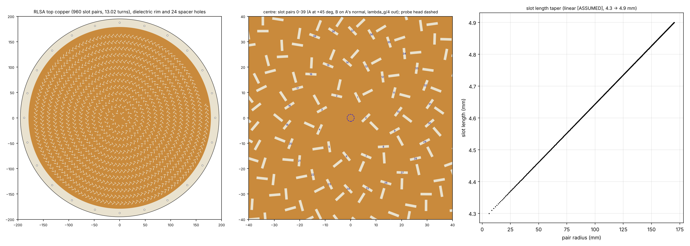
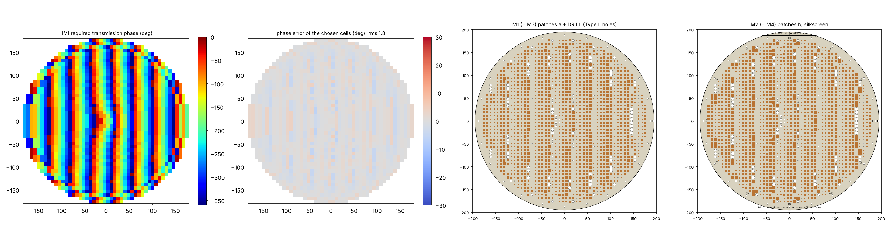
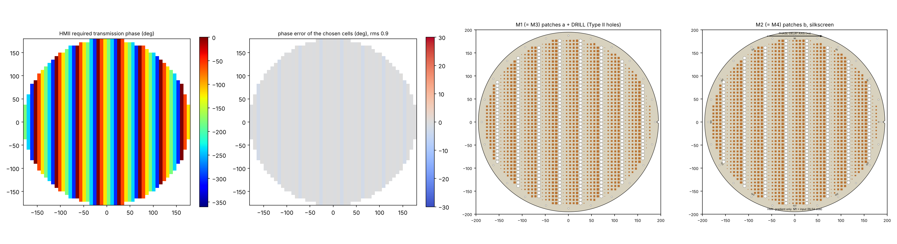
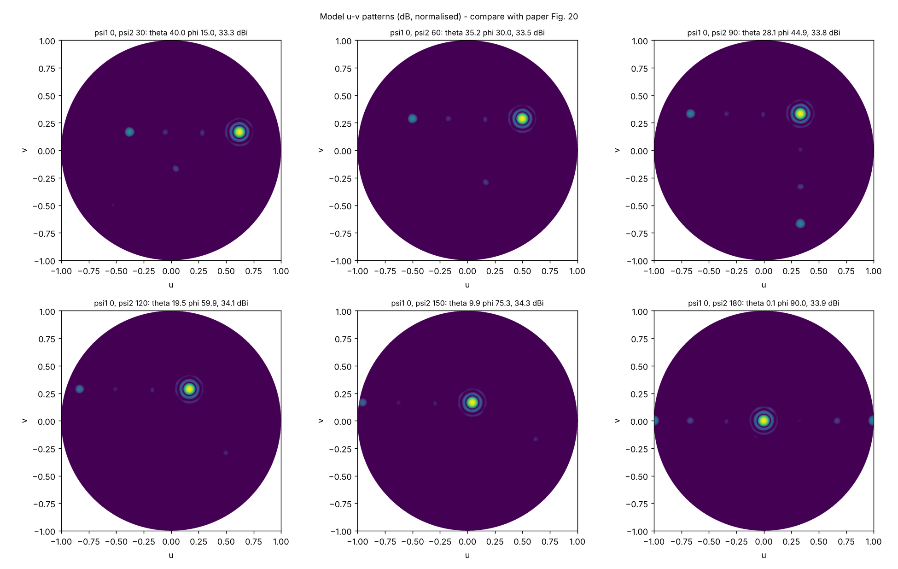
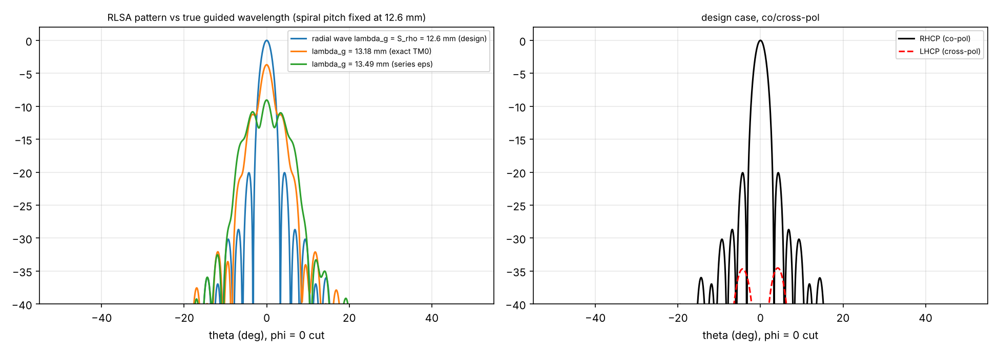
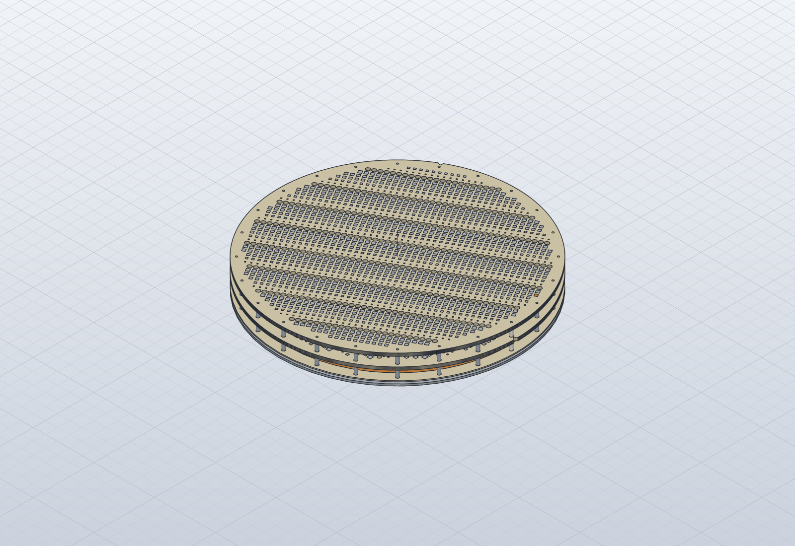

# NFMS Beam Steering of a CP RLSA with Hybrid Metasurfaces: Designer & Verification Guide

Companion to: M. U. Afzal, K. P. Esselle, M. N. Y. Koli, "A Beam-Steering Solution With Highly Transmitting Hybrid Metasurfaces and Circularly Polarized High-Gain Radial-Line Slot Array Antennas", *IEEE Trans. Antennas Propag.*, vol. 70, no. 1, pp. 365–377, Jan. 2022, DOI 10.1109/TAP.2021.3111522.

Everything numerical in this guide comes from `02_python/results/study_report.txt` and `01_dxf/DRC_report.txt`. Rerun `build_nfms.py`, `nfms_study.py` and `build_step.py` after any change.

---

## 1. The design in one page

- **Base antenna:** a fixed, circularly polarised (CP) radial-line slot array (RLSA) at 20 GHz, 345 mm across (23λ0).
  - The radial waveguide is 4.6 mm high: a 3 mm air gap above an aluminium plate, then a 1.6 mm TLY-5 laminate.
  - The radiating slots are etched in the top copper of the laminate.
  - A probe with a flat disc head feeds it from the centre.
  - 960 orthogonal slot pairs on a 13-turn outward spiral (pitch λg) radiate a broadside CP beam, about 34 dBic simulated.
- **Steering:** two thin, highly transmitting **hybrid metasurfaces (HMs)** sit in the near field of the RLSA. HM I is λ0 above it; HM II is above HM I.
  - Each HM imposes a linear phase gradient of −60° per 7.5 mm cell along its *phase-delay axis*. Alone, that tilts the beam by θ0 = 19.5°.
  - Rotating HM I to ψ1 and HM II to ψ2 adds the two gradients as vectors.
  - The beam goes to θ = asin(2 sin θ0 cos((ψ1−ψ2)/2)) and φ = (ψ1+ψ2)/2.
  - That covers a cone up to 41.9° (40.6° measured) at any azimuth, with the RLSA and its RF connector fixed.
- **HM I also corrects the RLSA's own non-uniform near-field phase** (about 190° spread, Fig. 12a). It uses a circularly symmetric approximation so that HM I can still rotate.
- **Why "hybrid":** a conventional metasurface cell can't cover 360° with |S21| > −1 dB. The paper's multilayer patch cell misses a 70° arc.
  - The HM mixes two unlike cells with non-overlapping phase ranges:
    - **Type I:** four square patches a, b, a, b on 3 × 1.6 mm TLY-5.
    - **Type II:** all dielectric, with a non-plated hole of radius r.
  - Together they leave only a 35° arc uncovered.
- **Measured:** peak 30.9 dBic (Table II gives 31.5 dBic at broadside), 26–27.1 dBic at 40.6°. AR < 3 dB within the 3 dB beamwidth. 3 dB gain bandwidth ≥ 0.89 GHz. Height 4.5 cm (3λ0).

---

## 2. Terminology

| Term | Meaning here |
|---|---|
| **NFMS, near-field meta-steering** | Beam steering by rotating phase-gradient metasurfaces placed in the near field (0.25–1λ0) of a fixed antenna. Similar to Risley prisms, but thin and close to the antenna. |
| **RLSA, radial-line slot array** | Planar high-gain antenna: a centre-fed radial parallel-plate waveguide whose top plate carries slots that leak the outward-travelling wave. |
| **Slot pair (CP)** | Two orthogonal slots, each at 45° to the radial direction, with the second one λg/4 further out. The 90° excitation delay plus the orthogonality gives CP. |
| **Spiral arrangement** | Rotating a CP pair by φ around the feed adds phase e^{jφ}. Placing the pairs on a spiral ρ = ρ0 + λg·φ/2π cancels it, so all pairs add in phase at broadside. |
| **λg, guided wavelength** | Wavelength of the radial wave in the partially filled waveguide. It sets the spiral pitch S_ρ. |
| **Phase-gradient (gradient phase profile)** | Linear transmission phase −Δφ per cell along one axis. It tilts a normally incident beam by θ0 = asin(Δφ λ0 / (2π d)) (eq. 5). |
| **Phase-delay axis** | The direction of decreasing transmission phase. The beam tilts toward it. Marked by the arrow and the +x notch on each HM. |
| **Correction phase** | Inverse of the RLSA's near-field phase, so that HM I sees an equi-phase aperture. |
| **Normalised phase** | Cell phase minus the phase of the Type II cell with the largest hole, so 0° = largest hole (paper, Sec. III-B). |
| **Supercell** | One period of the wrapped gradient: here 6 cells = 45 mm (0, −60, …, −300°). |
| **Unit-cell (Floquet) simulation** | One cell with periodic boundaries and a normally incident plane wave. It gives the S21 used to choose cells. |
| **Phase method** | The ray-optics prediction of the beam direction from p1, p2, ψ1, ψ2 (eqs. 1–2, ref. [27]). |

---

## 3. Verification of the paper's claims (done here)

| Claim / number in the paper | Check | Result |
|---|---|---|
| Eq. (5): Δφ = 60° for θ0 = 19.5°, d = 7.5 mm | 360·d·sin θ0 / λ0 | 60.13°, OK (rounded). 60° exactly ↔ θ0 = 19.46° |
| Table I predicted (θp, φp), eqs. (1), (6) | `nfms_study.py` [2] | All six reproduced to 0.05°, OK |
| Table I measured vs model | Aperture model with the chosen cells, rotated HM II | Model θ 40.0 / 35.2 / 28.1 / 19.5 / 9.9 / 0.1°, measured 40.6 / 35.7 / 28.2 / 20 / 10 / 0. Within 0.6°, OK |
| Eqs. (3)–(4), inverse problem | Forward-check the inverse | **Wrong by a factor 2.** The printed acos[(k sin θ)²/p1² − 1] is undefined above θ ≈ 28° and gives wrong angles below. The correct form is ψ1,2 = φ ± ½ acos[(k sin θ)²/(2p²) − 1], verified by the forward equations. `LUT_beam_to_rotation.csv` uses it. |
| Max elevation 40.6° | Eq. (1) with ψ1 = ψ2 | The hardware limit is **41.9°**. 40.6° is the ψ2 = 30° case; ψ1 = ψ2 was not measured. Model at ψ1 = ψ2 = 0: 41.8°. |
| ε_eff = 1.41, λg = 12.56 mm in the radial line | Exact TM0 transverse resonance of air 3 mm + TLY-5 1.6 mm | 1.41 is the volume average (gives λg = 12.62 mm). The physical TM0 value is **ε_eff = 1.294, λg = 13.18 mm** (quasi-static series limit 1.234 / 13.49 mm). |
| Consequence of the λg mismatch | Slot-dipole model with S_ρ = 12.6 mm, radial wave at the TM0 λg | Broadside drops **3.7 dB** (9 dB with the series value). This is a likely cause of the ~190° near-field phase ripple of Fig. 12(a), and of 34 dBi simulated against 37 dBi ideal. The correction phase in HM I partly undoes it. **Confirm λg with a 2-D eigenmode run before cutting the RLSA (sec. 8).** |
| 960 pairs on 13 rings | Spiral ρ0 = 6, S_ρ = 12.6, S_φ = 7.5 mm | 960 pairs give 13.02 turns, OK, and confirms the spiral reading |
| Aperture D = 345 mm | Outermost slot of the spiral | Outermost slot centre r = 173.3 mm. With L/2 the slot reaches 175.7 mm, **3.2 mm beyond 172.5**, so copper ≥ Ø352. We use Ø358. |
| Ideal directivity | 4πA/λ² with the 6 dB taper | 37.2 dBi uniform, 37.0 dBi tapered. Paper simulated 34 dBi, a 3 dB shortfall (see the λg row). |
| Aperture efficiency 22 % | 30.9 dBic at 20 GHz | 23.5 % over Ø345, **21.6 % over Ø360** (the HM aperture). The paper's 22 % uses the HM diameter. |
| Peak gain 30.9 dBic (abstract, text) vs 31.5 dBic (Table II) | Read Fig. 22 | 31.5 is the band maximum (19.4 GHz). 30.9 is at the design frequency. Not a contradiction, but the paper does not say so. |
| Gain at 40.6°: 26 dBic (text) vs 27.1 dBic (Table II) | Same reason | Band maximum vs single frequency |
| Type II cell, r 0 → 3.4 mm gives −169° → −134° | MG effective medium, exact slab | −170.3° → −133.3°, OK. The closed-form cell agrees within 1°. |
| Edge cell −13.8°: "Type II with hole **diameter** 2.8 mm" | Type II model | Diameter 2.8 (r = 1.4) gives −29.9°. **Radius** 2.8 gives −10.9°. The text very probably means r = 2.8 mm. |
| Centre cell −171°: Type I a = 4, b = 3.7 mm | Type I quasi-static ABCD | Quasi-static gives −134°. We fit one factor (C_SCALE = 1.42) on the grid capacitance so this cell lands on −171° (−0.63 dB). |
| Type I with |S21| > −1 dB: −169° … −458°, 70° gap; HM: 35° gap | Model library | The closed-form Type I leaves more gaps (largest 83°). Only the full-wave sweep (`04_hfss`) can confirm the paper's coverage. |
| Patch area limited to 36 % of the cell (a, b ≤ 4.5 mm) | Library with the limit | Inconsistent with the 0.2–7.2 mm sweep. With the limit the model leaves a 125° gap. Not applied. |
| "1/3 of HM II is metal-free" | Count Type II cells | With Type II covering 0…−35°, only the 0° column of each 6-column supercell is Type II, giving **1/6** (16.9 % here). 1/3 would need the −300° column to be Type II too. |
| Total height 4.5 cm = 3λ0 | Stack 4.6 + 15 + 4.8 + gap + 4.8 | With a 15 mm HM–HM gap the stack is 44.2 mm from the plate top. A 15.8 mm gap gives exactly 45. The HM–HM gap is not stated. |
| AR < 3 dB while steering | Slot model, broadside | 0.01 dB ideal at broadside. Steered AR depends on cell polarisation purity (sec. 8). |

**Model gain vs measured:** the aperture model gives 33.3–34.3 dBi, against 27.1–31.5 dBic measured. It leaves out dielectric and copper loss (about 0.7 dB per the paper), RLSA radiation efficiency, feed mismatch, the cells' oblique-incidence response, and HM–RLSA multiple reflections. So the model's scan loss (1 dB) is smaller than the measured 4.4 dB. Use the model for **direction and trends**, and HFSS or CST for gain.

---

## 4. Geometry and assumptions

**Frame:** z = 0 on the **top face of the Al ground plate**, z up. HM local frame: x = phase-delay axis.

| Item | Value | Source |
|---|---|---|
| f0, λ0 | 20 GHz, 14.99 mm (paper uses 15) | Sec. IV |
| Ground plate | Al, 3 mm, z −3 … 0 | Sec. V |
| Radial waveguide | air 3.0 mm (z 0 … 3) + TLY-5 1.6 mm (z 3 … 4.6), Wh = 4.6 mm | Fig. 9(a) |
| RLSA laminate | TLY-5 εr 2.2, tan δ 0.0009; bottom copper fully removed | Sec. V |
| Feed | SMA pin to z = 1.6, disc head Ø2.8 × 2.0 mm (z 1.6 … 3.6), 0.6 mm into a TLY-5 pocket | Fig. 9(a), read from the drawing |
| Slots | w = 1.0 mm, L 4.3 → 4.9 mm, first pair at ρ0 = 6 mm, S_ρ = 12.6 mm, S_φ = 7.5 mm, 960 pairs | Sec. IV-A |
| Slot length taper | **linear in radius** | **[ASSUMED]**. The paper refers to [43] |
| Pair layout | slot A at ρ, +45° to radial; slot B on A's normal, λg/4 = 3.15 mm further out (radially), −45° (a "T") | **[ASSUMED from the Fig. 9(b) inset]** |
| Spiral sense / CP hand | outward counter-clockwise; radiates ρ̂ − jφ̂ = e^{jφ}(x̂ − jŷ), **RHCP** for e^{jωt} | **[ASSUMED]**. The paper does not give the hand. Mirror the DXF for LHCP. |
| Top copper | Ø358 (outermost slot + 3 mm) | **[ASSUMED]** (see sec. 3) |
| Waveguide rim | open (no shorting wall, no absorber) | **[ASSUMED]**. The paper shows a bare dielectric rim (Fig. 16). |
| Dielectric / plate diameter | Ø390 incl. assembly rim | **[ASSUMED]** |
| HM cell | d = 7.5 mm, h = 4.8 mm (3 × 1.6 TLY-5), Cu 17 µm, prepreg ignored | Sec. III, V |
| HM grid | 48 × 48, centres −176.25 … +176.25; cells used where the centre radius ≤ 180 mm (1804 cells) | Fig. 11(b), Sec. IV-B ("extended by λ0/2") |
| Gradient | column i: −(180 + 60 i) mod 360 (−180, −240, −300, 0, −60, −120, …) | Sec. IV-B |
| Correction | −(Fig. 12a field phase) of the nearest of 24 rings | Fig. 12, digitised (`FIG12A_PHASE`) |
| HM rim | Ø390, 24 holes Ø3.0 on R187.5 (15° indexing), V notch at +x | holes Ø3 from the paper; count, radius and notch **[ASSUMED]** |
| Heights | HM I input face z = 19.6 (λ0 above the RLSA); HM I–HM II gap 15 mm | λ0 from the paper (Sec. IV-B); HM gap **[ASSUMED]** |
| Smallest drilled hole | r 0.4 mm (Ø0.8, 6:1 in 4.8 mm); smaller holes left out (< 0.6° effect) | ours |
| Cell choice | min ‖e^{jφt} − S21‖ over the whole library | ours (the paper: closest phase among > −1 dB). Both are in the study. |

---

## 5. Boards and files

| Folder | Files |
|---|---|
| `01_dxf/A_rlsa` | `RLSA_TLY5_1p6_960pairs.dxf`: copper with the slots cut, plus a separate `TOP_SLOT` layer. `RLSA_TOP_CU_uncut_plus_SLOT_layer.dxf` is for HFSS subtraction. `GROUND_PLATE_Al_3mm.dxf`. `slot_table.csv` lists all 960 pairs: centres, angles, lengths. |
| `01_dxf/B_hm1`, `C_hm2` | `HMn_48x48_all_layers.dxf` has M1–M4, DRILL, NPTH, silk and fab notes. `HMn_cell_assignment.csv` gives target and chosen phase, a, b, r, error and |S21| for every cell. `HMn_drill_table.csv`. |
| `01_dxf/D_fab_laminates` | One file per laminate: LAM1 (M1 bottom / M2 top), LAM2 (no Cu), LAM3 (M3 bottom / M4 top), plus the post-bond drill file. Top view, not mirrored. |
| `01_dxf/E_unit_cells` | The paper's two example cells (a 4 / b 3.7; r 2.8) plus r 1.4, for HFSS unit-cell checks |
| `06_step` | SolidCraft STEP AP242 files: RLSA + feed; HM1; HM2; the full stack at ψ1 = 0, ψ2 = 120° with spacers. The big files are zipped. |

**Stack-up (HM):** RLSA side → LAM1 (M1 | TLY-5 1.6 | M2) → prepreg → LAM2 (TLY-5 1.6) → prepreg → LAM3 (M3 | TLY-5 1.6 | M4) → output.

**Layers:**
- M1 = M3 hold the a-patches.
- M2 = M4 hold the b-patches.
- DRILL holes are non-plated, drilled after bonding.

**DRC (DRC_report.txt):**
- RLSA copper web between slots ≥ 1.5 mm.
- HM copper gap ≥ 0.7 mm. Smallest patch 0.3 mm.
- Drilled holes Ø1.5–6.8 mm, leaving ≥ 0.7 mm dielectric web.

---

## 6. Values for the first simulations

| Quantity | Start value |
|---|---|
| TLY-5 | εr 2.20, tan δ 0.0009 |
| Copper | σ 5.8e7 S/m, 17 µm (PerfE sheets for the first passes) |
| Al plate | σ 3.8e7 S/m |
| Prepreg (optional, 2 × 0.1 mm) | εr ≈ 2.7 (FR-27 class), tan δ 0.002 |
| Unit-cell sweep | Type I a, b 0.2 … 7.2 step 0.1; Type II r 0 … 3.4 step 0.05; 18.5–21.5 GHz |
| RLSA solver | time domain (paper: CST transient), or HFSS FE-BI. Radiation box ≥ λ0/4 |

---

## 7. HFSS steps and plots to check

`04_hfss/hfss_nfms_build.py` (PyAEDT, written for AEDT 2024.x, **not executed here**):

1. **`cell1` / `cell2`:** unit cells with Floquet ports de-embedded to the cell faces, and the parametric sweep.
   - Export S21 at 20 GHz as `02_python/results/hfss_cell_table.csv`, in the same columns as `cell_library.csv`.
   - Normalise the phase to Type II r = 3.4.
   - Rerun `build_nfms.py`. It picks the HFSS table up automatically and rewrites every HM DXF with full-wave cells.
2. **`rlsa`:** the RLSA alone, with probe, PTFE and wave port.
   - Check |S11| < −10 dB over 18–21 GHz (Fig. 18).
   - Check D ≈ 34 dBic at 20.1 GHz and the pattern cuts (Fig. 10).
   - Plot the Ey phase on z = 19.6 mm along −x and compare with Fig. 12(a) and `FIG12A_PHASE`. **If it differs, replace `FIG12A_PHASE` with your own probe values and rebuild HM I.** The correction must match *your* RLSA.
3. **`system psi1 psi2`:** the full stack, with HMs rotated.
   - Compare θ, φ with `results/steering_table.csv`.
   - Compare gain with Table II and AR with Fig. 21.

GUI fallback for any step:
1. Modeler → Import → DXF.
2. Set the elevations from sec. 4.
3. Subtract `TOP_SLOT` from `TOP_CU`, or the DRILL cylinders from the HM dielectric.
4. Assign PerfE to the copper sheets.

---

## 8. What the paper leaves out (important for a real build)

1. **λg of the radial line.** Don't build with S_ρ = 12.6 mm on trust.
   - A 2-D eigenmode of the 3 mm air + 1.6 mm TLY-5 parallel plate (or our TM0 solver, 13.18 mm) says S_ρ should be about 13.2 mm.
   - Either set `R["S_rho"]` to the solved λg and regenerate, or keep 12.6 mm and rely on HM I's correction. That copies the paper but wastes about 3–4 dB of RLSA directivity.
2. **Slot-length taper law and per-slot coupling.** The paper only gives 4.3/4.9 mm (ref. [43] holds the synthesis). For a uniform or tapered aperture, design the coupling vs radius with a few unit-slot simulations.
3. **Radial-line termination** at the rim (open, shorted, or absorber). This sets the residual wave and the RLSA S11 ripple.
4. **Probe dimensions:** the pin diameter and SMA type are not given. Tune the head height and diameter for S11 (variables `head_h`, `head_d`).
5. **Cell data:** the paper does not tabulate a, b, r against phase. Our closed-form models are a starting point. Run the unit-cell sweep before fabrication.
6. **Oblique incidence and polarisation:** HM I sees the RLSA near field, HM II a 19.5°-tilted wave. Check Type I/II S21 at 20° incidence and for both linear polarisations. A cell with unequal TE/TM phase degrades the AR.
7. **Edge cells:** the paper treats them like centre cells (Sec. VI). Expect small edge-diffraction lobes.
8. **Rotation hardware:** 24 rim holes give manual 15° steps. A motorised version (bearing + pancake stepper at the rim, Sec. VI) only adds lateral size.
9. **Handedness:** state RHCP or LHCP to the fabricator. Mirroring the RLSA DXF flips it, and the HMs are unchanged.

---

## 9. Paper targets (measured)

| ψ2 (ψ1 = 0) | θ / φ | Max gain (dBic) | 3 dB gain BW (GHz) |
|---|---|---|---|
| 30 | 40.6 / 15 | 27.1 | 1.10 |
| 60 | 35.7 / 30 | 28.2 | 1.05 |
| 90 | 28.2 / 45 | 29.6 | 0.94 |
| 120 | 20 / 60 | 30.0 | 0.94 |
| 150 | 10 / 75 | 30.0 | 0.94 |
| 180 | 0 / — | 31.5 | 0.89 |

The RLSA alone has |S11| < −10 dB over 18–21 GHz and D = 34 dB at 20.1 GHz with > 1 GHz 3 dB bandwidth. The full system has AR < 3 dB within the 3 dB beamwidth in all six cases.

---

## 10. Figures (generated)

